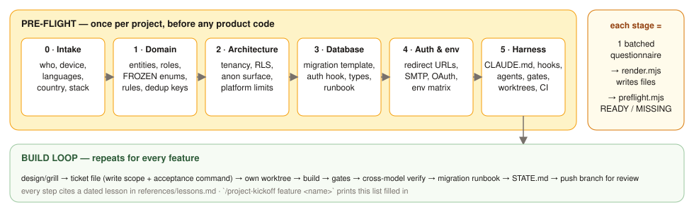
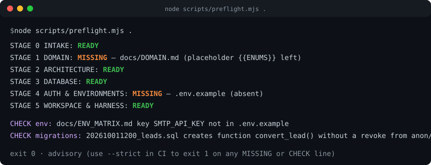
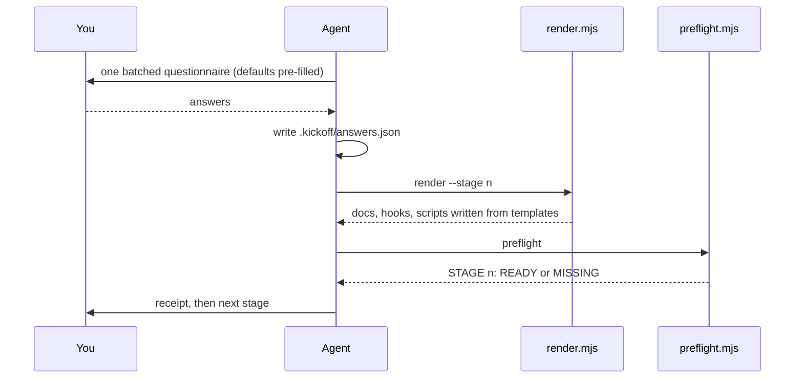
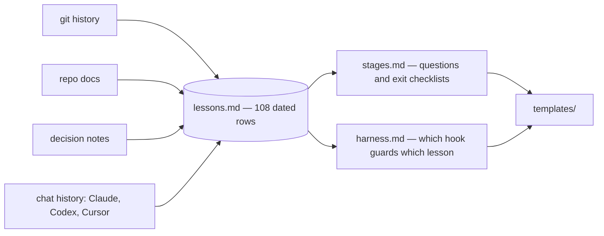

<div align="center">


# project-kickoff

**Make the expensive decisions while they're still cheap.**
Ask the right questions *before* the first line of code. Generate the docs and guardrails. Never lose a lesson twice.

[](#install)
[](#install)
[](#install)
[](#install)
[](#verify)
[](LICENSE)

</div>

---

## At a glance

| 🧑 You do | ⚙️ It does | 🎁 You get |
|---|---|---|
| Type `/project-kickoff` in a fresh repo and answer **six short questionnaires** | Turns your answers into **real files** (docs, `AGENTS.md`, hooks, sub-agents, gate runner, CI) and checks what's missing | A project that starts with its guardrails, plus a **build-loop checklist** for every feature |

Every question exists because something specific went wrong on a real three-month build. There are
**108 dated lessons** behind the checklist, and the agent can quote the one behind any rule.

<p align="center">
  
</p>

---

## Why

Building a multi-tenant CRM with Claude Code, Codex and Cursor took three months. In hindsight most of the
time went to **preparation that arrived late**, not to code:

| 🔥 What went wrong | 📍 Found | 💸 Cost |
|---|---|---|
| Auth redirect URLs, magic links and set-password flow misconfigured | day one, by a non-technical user | sessions of debugging |
| Data model (enums, ownership, dedup keys) decided piecemeal | across 63 migrations | re-migrations, contract breaks |
| Test gates passed only in the main checkout (gitignored `.env`) | first unattended agent run | a full run wasted |
| Migration shipped without the deploy that needed it | three separate times | silent production failures |
| Migration numbers collided across branches | three times | live names ≠ repo files |
| Sessions died at quota limits with state only in chat | repeatedly | "refresh my memory where we stopped" |
| Guardrails written in week 1, never grew | until week 11 | every gap above stayed open |

`project-kickoff` asks about each of these **at the stage where the answer is still cheap**, writes it to a
file a script can check, and generates the guardrail so the next project does not depend on anyone's memory.

---

## What it does

- 🧭 **Six pre-flight stages, one batched questionnaire each** — 3–6 questions, defaults pre-filled, silence = default. No drip-fed interruptions.
- 📄 **Answers become files** — `render.mjs` writes `DOMAIN.md`, `ARCHITECTURE.md`, `ENV_MATRIX.md`, `MIGRATION_RUNBOOK.md`, `STATE.md`, `AGENTS.md`, hooks, agents, scripts and CI from templates. Nothing lives only in the chat.
- 🔎 **Advisory checker** — `preflight.mjs` prints `READY` / `MISSING` per stage plus cross-checks (env keys vs matrix, tables without RLS, functions callable by anon). Never blocks; `--strict` for CI.
- 🛡️ **Guardrails generated, not remembered** — four hooks (env-edit, destructive SQL, service-role, migration-number), two sub-agents (quality-gate, rls-auditor), a gate runner, a safe worktree script, a clean-clone CI workflow.
- 🔁 **Build-loop checklist per feature** — design → ticket → build route (kickoff loop or Crew) → worktree → gates → cross-model verify → migration runbook → `STATE.md`.
- 📚 **108 dated lessons with evidence** — every checklist item cites one. Ask *why* and get the commit, the doc line, or the chat that taught it.
- 🧱 **Stack profiles** — Supabase + React/Vite + Vercel ships as default with a platform-limits sheet; add your own in one file.
- 🤝 **Runs in Claude Code, Codex CLI and Cursor** — same folder, no build, no dependencies.

---

## Install

```bash
# 1. install (Claude Code)
git clone https://github.com/EranTzarum/project-kickoff.git ~/.claude/skills/project-kickoff

# 2. verify
node --test ~/.claude/skills/project-kickoff/scripts/preflight.test.mjs   # ℹ pass 4 / ℹ fail 0

# 3. in your new (or young) project, inside Claude Code:
/project-kickoff
```

Then answer the stage-0 questions. The agent renders the files, runs the checker, prints a one-screen receipt
(files written · missing items · owner actions) and moves on to stage 1.

> [!TIP]
> Already mid-project? Run `/project-kickoff status`. It only reports what's missing and changes nothing.

<details>
<summary><b>Install for Codex CLI and Cursor too</b></summary>

Copy (or clone) the same folder into each harness's user skill root. The folder name must stay `project-kickoff`.

| Harness | Skill root |
|---|---|
| Claude Code | `~/.claude/skills/project-kickoff` |
| Codex CLI | `~/.codex/skills/project-kickoff` |
| Cursor | `~/.cursor/skills/project-kickoff` |

Codex and Cursor have no question widget: the agent prints the same questionnaire as a numbered list with the
defaults marked and waits for your reply. They also do not run Claude Code hooks; for them the generated
`AGENTS.md` (the only instruction file) plus the CI workflow are the enforcement.
</details>

---

## Try it

In an empty repo, type `/project-kickoff`. Stage 0 arrives as one short form, with defaults filled in:

```text
Stage 0 · Intake  (reply with changes only; silence = default)
1. Name, one-line purpose, primary user and device   [field agent · phone]
2. UI languages, default first; right-to-left?        [en · no RTL]
3. Country of the business                            (no default - drives payments, legal text, phone formats)
4. Stack profile                                      [supabase-react-vercel]
```

You answer *"a booking app for small clinics; receptionist on a desktop; Spain"*. A few seconds later:

```text
Stage 0 receipt
  written   docs/KICKOFF.md · STATE.md
  checker   STAGE 0: READY
  owner     log in to the GitHub, hosting and database CLIs (agents can't do this for you)
  next      Stage 1 · Domain & data model
```

Nothing is committed or deployed. Every file is yours to review.

---

## Usage

| Command | What happens |
|---|---|
| `/project-kickoff` | Runs stages 0 → 5, starting at the first stage with missing deliverables |
| `/project-kickoff status` | Runs the checker only. Prints the stage table. Changes nothing |
| `/project-kickoff retro` | Drafts lesson candidates from `STATE.md` and the ledger; after you fill in the rules, saves them to your own lesson store |
| `/project-kickoff adopt` | For an existing repo: dry-run report, then writes only the manifest |
| `/project-kickoff stage 3` | Re-asks stage 3's questionnaire and re-renders its files |
| `/project-kickoff feature <name>` | Prints the build-loop checklist filled in for one feature; asks the build route (kickoff loop or Crew) when Crew is installed |

### What the checker prints

<p align="center">
  
</p>

```bash
node scripts/preflight.mjs .            # advisory, always exit 0
node scripts/preflight.mjs . --strict   # CI: exit 1 on any MISSING or CHECK line
```

### Owner actions

Some prerequisites cannot be done by an agent: registering redirect URLs, configuring SMTP, submitting OAuth
verification, setting secrets in the hosting dashboard, choosing a database plan. Each stage's receipt lists
them, and `docs/KICKOFF.md` keeps a dated log so they are never forgotten.

---

## How it works



Three ideas make this more than a wiki checklist:

1. **Ask once, batched, with defaults.** One short form per stage instead of forty interruptions.
2. **Files, not chat.** `render.mjs` turns answers into the repo's real docs and guardrails. A session that dies at a quota ceiling loses nothing; you can even continue on a different agent.
3. **A script says what is missing.** `preflight.mjs` reads `docs/KICKOFF.md` (the deliverable manifest) and refuses to let a gap be invisible — without ever blocking you.

### The six stages

| # | Stage | Asks about | Produces | Example lessons |
|---|---|---|---|---|
| 0 | **Intake** | purpose, primary user & device, languages/RTL, country, stack profile, who plans vs who codes | `docs/KICKOFF.md`, `STATE.md` | payment provider must support the country (L1) · tooling bring-up is its own checklist (L4) |
| 1 | **Domain & data model** | entities, roles, lifecycle enums, rules with numbers, data conventions, dedup keys, out of scope | `docs/DOMAIN.md` | freeze enums early (L15) · "3.5" = 3,500,000 written down (L13) · publish ≠ lifecycle ≠ archive (L14) |
| 2 | **Architecture & security** | tenancy, service-role allowlist, anon surface, frozen contracts, peer-read paths, platform limits, size budgets | `docs/ARCHITECTURE.md` | revoke EXECUTE on every function (L22) · Hobby plan = one cron/day (L25) · canonical domain in config (L27) |
| 3 | **Database** | prod + separate test project, naming, types targets, backups | migration template, auth-hook recipe, `db-types.mjs`, runbook | hook role needs its own policy (L37) · no partial index behind an upsert (L41) · CHECK passes on NULL (L43) |
| 4 | **Auth & environments** | origins per env, SMTP, OAuth, Preview isolation | `docs/ENV_MATRIX.md`, `.env.example` | redirect URLs before the first invite (L50) · SMTP before auth mail (L52) · Preview gets no prod secrets (L56) |
| 5 | **Workspace & harness** | gate commands, deploy rule, worker platforms, shell & line endings | `AGENTS.md`, hooks, agents, `gates.mjs`, worktree scripts, CI | gates pass in a clean worktree (L60) · never junction `node_modules` (L62) · deploy from `main` only (L65) |
| 6 | **Build loop** | per feature | checklist | build route: kickoff loop or Crew (L107) · acceptance as invariants not counts (L82) · cap identical retries at 2 (L89) · orchestrator routes, workers build (L91) |

### Already mid-project?

Run `/project-kickoff adopt`. It maps the docs you already have onto the deliverables, writes only the
manifest (`docs/KICKOFF.md`), and ranks the gaps by risk. Later stages render only what is missing.
Details: [`references/adopt.md`](references/adopt.md).

### What lands in your project

```
docs/KICKOFF.md              stage tracker — one row per deliverable; the checker reads this
docs/DOMAIN.md               glossary · entities · roles · FROZEN enums · rules · dedup keys · out of scope
docs/ARCHITECTURE.md         tenancy · privileged access · anon surface · identity trust · limits · budgets
docs/ENV_MATRIX.md           environment tiers (one row per tier) · env vars · redirect URLs · SMTP · OAuth · databases
docs/LAUNCH.md               owner-only launch blockers from day 1: steps, minutes, what each unblocks
docs/MIGRATION_RUNBOOK.md    naming · template rules · additive → deploy → revoke · rollback
STATE.md                     the ONE living "where are we" file (done / in flight / next / mistakes made)
AGENTS.md                   rules file (always / never); the only instruction file
.gitattributes                LF for scripts and CI (*.sh, *.yml, Caddyfile, Dockerfile)
.env.example                 keys only — cross-checked against ENV_MATRIX
supabase/migrations/         _TEMPLATE.sql (RLS + revokes + CHECK-not-null baked in) · auth-hook recipe
.claude/settings.json        hook wiring
.claude/hooks/               block-env-edit · block-destructive-sql · service-role-guard · migration-number-check
.claude/agents/              quality-gate · rls-auditor
scripts/                     gates.mjs · db-types.mjs · worktree-setup.ps1/.sh · preflight.mjs
.github/workflows/           gates.yml (clean clone, no secrets) · keepalive.yml (free-tier DB)
.kickoff/answers.json        your answers — re-render any stage from them
```

---

## The lessons behind the checklist

[`references/lessons.md`](references/lessons.md) — **108 rows**, each with a date, a category, what happened,
the evidence (commit hash, doc line or chat), the rule it produced and the stage that now owns it. Mined from a
real project's git history (365 commits, 63 migrations), its docs, the author's decision notes, and the
author's chat history across Claude Code, Codex and Cursor. Each lesson names its source project and class; community lessons come by PR ([`CONTRIBUTING.md`](CONTRIBUTING.md)).



Ask the agent *"why does stage 3 insist on the hook role's own policy?"* and it quotes **L37**: the access-token
hook "succeeded" for a day while never stamping the tenant claim, because the hook's role could not read the
membership table.

---

## Repository map

<details>
<summary><b>Show the tree</b></summary>

```
SKILL.md                                  agent-facing instructions: modes, rules, stage loop
AGENTS.md                                 rules for agents working on this repo (gates, public-repo rule)
agents/openai.yaml                        Codex display metadata
references/
  stages.md                               questionnaire · deliverables · exit checklist per stage (cites lessons)
  lessons.md                              108 dated lessons
  harness.md                              which generated file guards which lesson; what Codex/Cursor lack
  stack-profiles/supabase-react-vercel.md defaults + platform-limits sheet
templates/
  PLACEHOLDERS.md                         every {{PLACEHOLDER}} and its meaning
  answers.example.json                    complete example answers (also the test fixture)
  docs/ env/ db/ claude/ scripts/ ci/     the files rendered into a project
scripts/
  render.mjs                              answers.json → files; skips existing; --force to regenerate
  preflight.mjs                           the advisory checker (copied into each project so CI can run it)
  preflight.test.mjs                      node --test
  to-crew.mjs                             a feature's tickets → Crew crew.json
  build-route.mjs                         detects Crew; logs the build route
  lessons.mjs                             lints references/lessons.md (sources, classes, cited ids)
  retro.mjs                               drafts lesson candidates; saves them to your own lesson store
docs/assets/                              images used by this README
```

</details>

---

## Verify

```bash
node --test scripts/preflight.test.mjs scripts/hooks.test.mjs scripts/render.test.mjs scripts/measure.test.mjs scripts/render-mapping.test.mjs scripts/adopt.test.mjs scripts/env-tiers.test.mjs scripts/line-endings.test.mjs scripts/owner-steps.test.mjs scripts/launch.test.mjs scripts/to-crew.test.mjs scripts/build-route.test.mjs scripts/lessons.test.mjs scripts/retro.test.mjs
node scripts/lessons.mjs --lint
```

The test renders the example answers into a temp folder and proves: every stage READY after a full render;
MISSING plus `--strict` exit 1 after deleting a deliverable; leftover placeholders, env drift, a table without
RLS and a function without a revoke are all reported; advisory mode always exits 0.

---

## Extend

- **New stack** — copy `references/stack-profiles/supabase-react-vercel.md`, change defaults and the limits sheet, add stack-specific templates and map them in `scripts/render.mjs` (`STAGE_FILES`).
- **New lesson** — add a row to `references/lessons.md` with the next id, cite it from the owning stage in `references/stages.md`, and if it deserves a guardrail, add the template plus a row in `references/harness.md`.
- **New check** — extend `scripts/preflight.mjs`, add a case to the test, keep it advisory.

---

## FAQ

<details><summary><b>Does it write code for my app?</b></summary>

No. It writes preparation: docs, rules, hooks, scripts, CI. Product code starts after stage 5.
</details>

<details><summary><b>Will it overwrite my files?</b></summary>

No. `render.mjs` skips anything that exists; `--force` is explicit.
</details>

<details><summary><b>Does it commit, deploy or touch secrets?</b></summary>

No. Those stay human actions and are listed as owner actions.
</details>

<details><summary><b>Is it Supabase-only?</b></summary>

The stages are stack-agnostic; the default profile is Supabase + React/Vite + Vercel because that is where the lessons came from. Add a profile for your stack.
</details>

<details><summary><b>What if I already have a project?</b></summary>

Run `/project-kickoff status`. It prints one MISSING line for the tracker and changes nothing; you can then backfill stage by stage.
</details>

<details><summary><b>Why advisory instead of blocking?</b></summary>

Blocking recreates the per-step permission friction that makes agent work slow. A MISSING line is a to-do you can see; CI gets `--strict`.
</details>

---

## License

[MIT](LICENSE) © 2026 Eran Tzarum

<div align="center"><sub>Ninety-nine lessons, learned once, so you don't have to.</sub></div>
