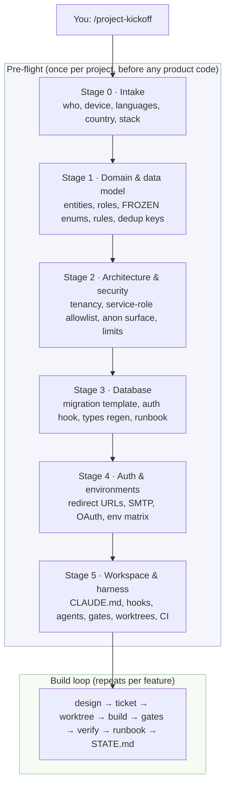
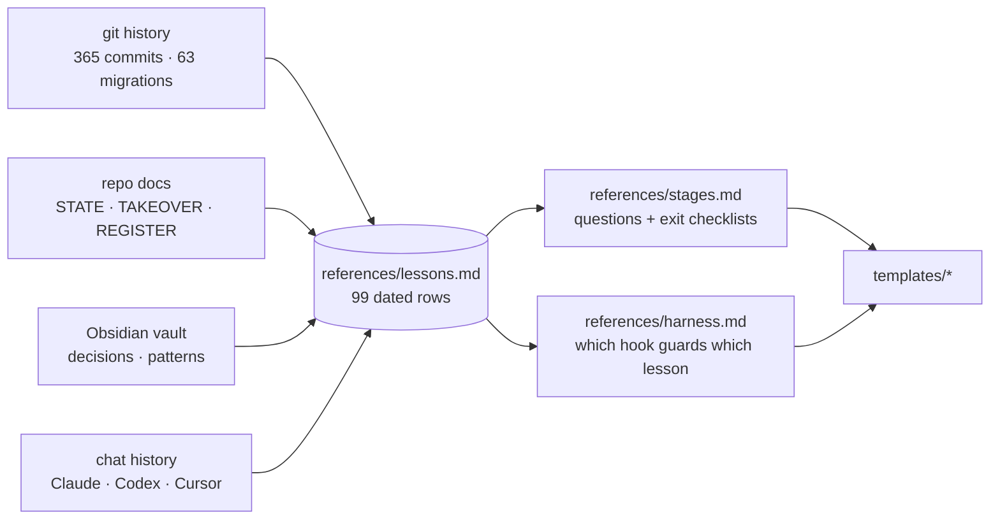

# project-kickoff

**A staged pre-flight for building a new site or system with AI coding agents.**
It makes the agent ask the right questions *before* the first line of product code, generates the project's
docs and guardrails from templates, and keeps an advisory checklist visible for the whole build.

Works as a skill for **Claude Code** (primary), **Codex CLI** and **Cursor**. No dependencies beyond Node 18+.

---

## Why this exists

This skill is a retrospective turned into a program. Its author spent three months building a multi-tenant CRM
(React + Vite, Supabase, Vercel) with Claude Code, Codex and Cursor. Looking back, most of the lost time was
**preparation that arrived late**, not code that was hard to write:

| What went wrong on the CRM | When it was discovered | What it cost |
|---|---|---|
| Auth redirect URLs, magic links and the set-password flow were misconfigured | day one, by a non-technical user in production | several sessions of debugging |
| The data model (enums, ownership, sharing, dedup keys) was decided piecemeal | across 63 migrations and repeated hardening passes | re-migrations, re-imports, contract breaks |
| Test gates only passed in the main checkout (a gitignored `.env`) | the first unattended multi-agent run | a full run wasted |
| Migrations shipped without the deploy that needed them, or the other way round | three separate times, weeks apart | silent production failures |
| Migration numbers collided across parallel branches | three times | live names diverged from repo files |
| Sessions died at quota ceilings with state only in the chat | repeatedly | "refresh my memory where we stopped" |
| Guardrails (hooks, agents, rules) landed in week 1 and did not grow | until week 11 | every gap above stayed open |

`project-kickoff` asks about each of those things at the stage where the answer is still cheap, writes the
answer into a file the checker can see, and generates the guardrail so the next project never relies on memory.

---

## How it works, in one picture



Every stage has the same shape:

```mermaid
sequenceDiagram
    participant You
    participant Agent as Agent (Claude / Codex / Cursor)
    participant R as render.mjs
    participant C as preflight.mjs

    Agent->>You: ONE batched questionnaire (3–6 questions, defaults pre-filled)
    You-->>Agent: answers (silence = default)
    Agent->>Agent: writes .kickoff/answers.json
    Agent->>R: render --stage n
    R-->>Agent: docs / hooks / scripts written from templates
    Agent->>C: preflight
    C-->>Agent: STAGE n NAME: READY | MISSING — items
    Agent->>You: receipt: files written · missing items · owner actions
    Note over Agent,You: no per-step permission prompts; next stage starts automatically
```

Three things make this different from a checklist in a wiki:

1. **Questions are asked once, batched, with defaults.** You answer a short form per stage instead of being
   interrupted forty times.
2. **Answers become files, not chat.** `render.mjs` turns the answers into the project's real docs and guardrails.
   Nothing lives only in the conversation, so a session that dies at a quota ceiling loses nothing.
3. **A script says what is missing.** `preflight.mjs` reads the tracker and prints READY / MISSING per stage.
   It is advisory: it never blocks you, it just refuses to let a gap be invisible. `--strict` makes it fail in CI.

---

## What you get in a kicked-off project

```
docs/KICKOFF.md              stage tracker: one row per deliverable — the checker reads this
docs/DOMAIN.md               glossary, entities, roles, FROZEN enums, domain rules, dedup keys, out of scope
docs/ARCHITECTURE.md         tenancy, privileged access, anon surface, identity trust, integrations, platform limits
docs/ENV_MATRIX.md           every env var × Dev/Preview/Prod, redirect URLs, SMTP, OAuth, databases
docs/MIGRATION_RUNBOOK.md    naming, template rules, additive → deploy → revoke order, rollback
STATE.md                     the ONE living "where are we" file (done / in flight / next / mistakes already made)
CLAUDE.md + AGENTS.md        the rules file (what to always / never do), identical copy for Codex & Cursor
.env.example                 keys only, cross-checked against ENV_MATRIX
supabase/migrations/         _TEMPLATE.sql (RLS + revokes + CHECK-not-null baked in) and the auth-hook recipe
.claude/settings.json        hook wiring
.claude/hooks/               block-env-edit · block-destructive-sql · service-role-guard · migration-number-check
.claude/agents/              quality-gate · rls-auditor
scripts/                     gates.mjs · db-types.mjs · worktree-setup.ps1/.sh · preflight.mjs
.github/workflows/           gates.yml (clean-clone gates, no secrets) · keepalive.yml (free-tier DB)
.kickoff/answers.json        your answers — re-render any stage from them
```

Each guardrail exists because something specific went wrong once. The full map is in
[`references/harness.md`](references/harness.md).

---

## The evidence behind every checklist item

[`references/lessons.md`](references/lessons.md) holds **99 dated lessons**, each with its evidence
(commit hash, doc line, or chat) and the rule it produced. They were mined from:

- the CRM's git history (365 commits, 63 migrations) and its docs,
- the author's Obsidian vault (decisions and patterns),
- the author's chat history across Claude Code (`history.jsonl`, claude-mem), Codex (`state_5.sqlite`)
  and Cursor (composer store, agent transcripts).

Every question in [`references/stages.md`](references/stages.md) and every checklist item cites a lesson id
(`L37`, `L60`, …). Ask the agent *"why does stage 3 insist on the hook role's own policy?"* and it quotes L37:
the CRM's access-token hook "succeeded" for a day while never stamping the tenant claim.



---

## Install

Clone into the skill root of each harness you use (the folder name must stay `project-kickoff`):

```bash
git clone git@github.com:EranTzarum/project-kickoff.git ~/.claude/skills/project-kickoff
```

| Harness | Skill root |
|---|---|
| Claude Code | `~/.claude/skills/project-kickoff` |
| Codex CLI | `~/.codex/skills/project-kickoff` |
| Cursor | `~/.cursor/skills/project-kickoff` |

Copy the same folder to the other roots (or clone three times). No build step, no `npm install`.

Verify:

```bash
node ~/.claude/skills/project-kickoff/scripts/preflight.test.mjs
```

Expected: `ℹ pass 4` / `ℹ fail 0`.

---

## Use

| You type | What happens |
|---|---|
| `/project-kickoff` in an empty (or young) repo | runs stages 0→5 in order, starting at the first stage whose deliverables are missing |
| `/project-kickoff status` | runs the checker only; prints the stage table; changes nothing |
| `/project-kickoff stage 2` | re-asks stage 2's questionnaire and re-renders its deliverables |
| `/project-kickoff feature <name>` | prints the build-loop checklist (stage 6) filled in for one feature |

In Codex or Cursor, where no question widget exists, the agent prints the same questionnaire as a numbered list
with defaults and waits for your reply.

**Owner actions.** Some prerequisites cannot be done by an agent: registering redirect URLs, configuring SMTP,
submitting OAuth verification, setting secrets in the hosting dashboard, choosing a database plan. Each stage
ends with a receipt listing them, and `docs/KICKOFF.md` keeps a dated log so they do not get forgotten.

### Example checker output

```
STAGE 0 INTAKE: READY
STAGE 1 DOMAIN: MISSING — docs/DOMAIN.md (placeholder {{ENUMS}} left)
STAGE 2 ARCHITECTURE: READY
STAGE 3 DATABASE: READY
STAGE 4 AUTH & ENVIRONMENTS: MISSING — .env.example (absent)
STAGE 5 WORKSPACE & HARNESS: READY
CHECK env: docs/ENV_MATRIX.md key SMTP_API_KEY not in .env.example
CHECK migrations: 202610011200_leads.sql creates function convert_lead() without a revoke from anon/public
```

Exit code is always 0. `node scripts/preflight.mjs . --strict` exits 1 on any MISSING or CHECK line — use that in CI.

---

## The stages in detail

| # | Stage | It asks about | It produces | Lessons it encodes (examples) |
|---|---|---|---|---|
| 0 | Intake | purpose, primary user & device, languages/RTL, country, stack profile, who plans vs who codes | `docs/KICKOFF.md`, `STATE.md` | payment provider must support the country (L1); tooling bring-up is its own checklist (L4) |
| 1 | Domain & data model | entities, roles, lifecycle enums, domain rules with numbers, data conventions, dedup keys, out of scope | `docs/DOMAIN.md` | enums frozen early (L15); "3.5" = 3,500,000 written down (L13); publish ≠ lifecycle ≠ archive (L14) |
| 2 | Architecture & security | tenancy model, service-role allowlist, anon surface, frozen contracts, peer-read paths, platform limits, size budgets | `docs/ARCHITECTURE.md` | revoke EXECUTE on every function (L22); Hobby plan = one cron per day (L25); canonical domain in config (L27) |
| 3 | Database | prod + separate test project, naming, types targets, backups | migration template, auth-hook recipe, `db-types.mjs`, runbook | hook role needs its own policy (L37); no partial index behind an upsert (L41); CHECK passes on NULL (L43) |
| 4 | Auth & environments | origins per env, SMTP, OAuth providers, Preview isolation | `docs/ENV_MATRIX.md`, `.env.example` | redirect URLs before the first invite (L50); SMTP before auth mail (L52); Preview gets no prod secrets (L56) |
| 5 | Workspace & harness | gate commands, deploy rule, worker platforms, shell & line endings | `CLAUDE.md`, hooks, agents, `gates.mjs`, worktree scripts, CI | gates pass in a clean worktree (L60); never junction node_modules (L62); deploy from main only (L65) |
| 6 | Build loop | (per feature) | checklist | acceptance as invariants not counts (L82); cap identical retries at 2 (L89); orchestrator routes, workers build (L91) |

The default **stack profile** is Supabase + React/Vite + Vercel + Claude Code. It pre-fills every default and
ships a platform-limits sheet ([`references/stack-profiles/supabase-react-vercel.md`](references/stack-profiles/supabase-react-vercel.md)).
Add another profile by copying that file; the stages themselves are stack-agnostic.

---

## Repository map

```
SKILL.md                              the agent-facing instructions: modes, rules, stage loop
agents/openai.yaml                    Codex display metadata
references/
  stages.md                           questionnaire + deliverables + exit checklist per stage (cites lessons)
  lessons.md                          99 dated lessons: what happened · evidence · rule · owning stage
  harness.md                          which generated file guards which lesson; what Codex/Cursor lack
  stack-profiles/supabase-react-vercel.md   defaults + platform-limits sheet
templates/
  PLACEHOLDERS.md                     every {{PLACEHOLDER}} and its meaning
  answers.example.json                a complete example answers file (also the test fixture)
  docs/  env/  db/  claude/  scripts/  ci/    the files rendered into a project
scripts/
  render.mjs                          answers.json → files; skips existing; --force to regenerate
  preflight.mjs                       the advisory checker (copied into each project so CI can run it)
  preflight.test.mjs                  node --test: full render READY, MISSING + strict, placeholder/env/RLS checks
```

---

## Design choices (and why)

- **Advisory, not blocking.** A MISSING line is a to-do, not a stop sign. Blocking would recreate the per-step
  permission friction that makes agent work slow; CI gets `--strict` instead.
- **One batched questionnaire per stage.** Fewer interruptions than one question at a time; more steering than
  "accept all defaults".
- **Files over conversation.** Every answer is rendered into the repo. Wallet rotation (Claude → Codex → Cursor
  when a quota dies) works because nothing important is in the chat.
- **Templates, not free-form generation.** The agent fills placeholders; it does not improvise a CLAUDE.md.
  `render.mjs` refuses to overwrite and reports unfilled placeholders; the fix is always "add the answer".
- **Every rule cites a lesson.** A rule without a dated lesson row is an opinion. Keep `lessons.md` growing:
  a new trap in any project gets a row and a stage that owns it.
- **No git, no deploy, no secrets from the skill.** It writes files. Committing, pushing, deploying and
  filling real `.env` values stay human actions, listed as owner actions.

---

## Extending

- **New stack:** copy `references/stack-profiles/supabase-react-vercel.md`, change the defaults and the limits
  sheet, add any stack-specific templates under `templates/` and map them in `scripts/render.mjs` `STAGE_FILES`.
- **New lesson:** add a row to `references/lessons.md` with the next id, cite it from the stage that owns it in
  `references/stages.md`, and — if it deserves a guardrail — add the template and a row in `references/harness.md`.
- **New check:** extend `scripts/preflight.mjs`, add a case to `preflight.test.mjs`, keep it advisory.

Run the tests after any change:

```bash
node --test scripts/preflight.test.mjs
```

---

## Status

Built 2026-09-28 from the Real Estate CRM retrospective. First use on a fresh project pending; expect the
questionnaires and defaults to tighten after that.
